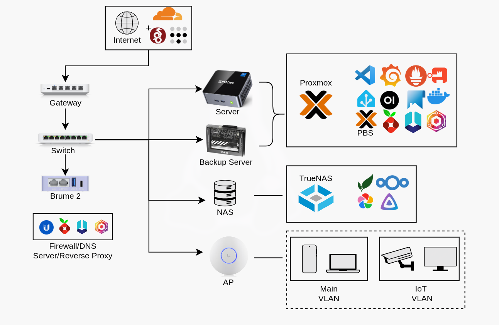

# Home Infrastructure Lab
An on premise self-hosted infrastructure environment for accelerated learning in IT, System Administration and DevOps.

## Background
Just a guy that enjoys learning, building and breaking stuff (mostly breaking). Check out my resume if you want to see my technical background.

[Click here for Resume](Resume.pdf)

## Network Diagram


## Hardware

### NAS
- TrueNAS
- Intel N100 4 Core 4 Threads
- 500W PSU
- 128GB NvME SSD
- 32GB DDR5 SODIMM RAM
- 2 x 4TB Mirrored HDD Red Iron Wolf 5200RPM

### Main Server
**Current**
- GMKtec Mini PC Gaming, M7 AMD Ryzen 7 PRO 6850H
- Proxmox
- 8 Core 16 Thread AMD
- 32GB RAM
- 1TB NvME SSD
  
**Old**
- Proxmox
- 8 Core 16 Thread AMD AM4
- 32GB RAM
- 500GB NvME SSD, 1TB NvME SSD
- 600W PSU

### Backup server
- Zimablade
- Proxmox
- Intel E3950 4 Core 4 Threads
- 16GB DDR3L
- 32GB eMMC 5.1, 1TB SSD

### Network
- Ubiquiti Cloud Gateway Max
- Ubiquiti Lite 8 PoE
- U6+ Access Point
- Brume 2 GL-MT2500 Security Gateway

### Travel
- Beryl GL-MT3000 Travel Router

### UPS
- APC 1500VA Backup UPS


## Mini Rack Build

GeeekPi 10 inch 8U Server Cabinet that contains network infrastructure, NAS and backup server

```
|      Top      |
| _ _ _ _ _ _ _ |
|       1       |
| _ _ _ _ _ _ _ |
|       2       |
| _ _ _ _ _ _ _ |
|       3       |
| _ _ _ _ _ _ _ |
|               |
|     Bottom    |
|               |
| _ _ _ _ _ _ _ |
```

### Top 
- Zimablade
- U6+ Access Point
- GL-MT2500 Security Gateway

### 1 (Gateway)
- Ubiquiti Cloud Gateway Max

### 2 (Switch)
- Ubiquiti Lite 8 POE

### 3 (NAS)
- TrueNAS Server DIY Build

### Bottom
- NAS Storage
- NAS PSU

## SaaS
**Cloudflare** - CDN and DNS provider

**Tailscale**  - VPN service for remote access

**Proton VPN** - Secure internet traffic across network
